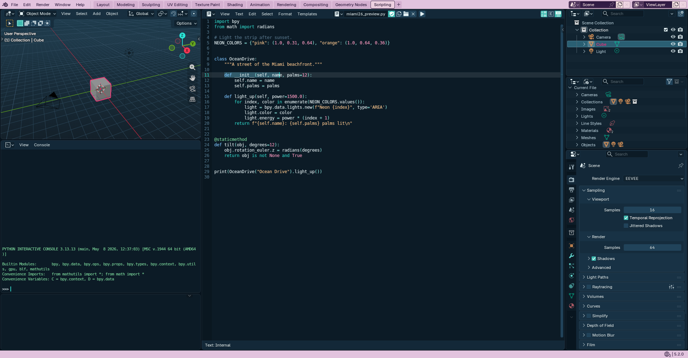
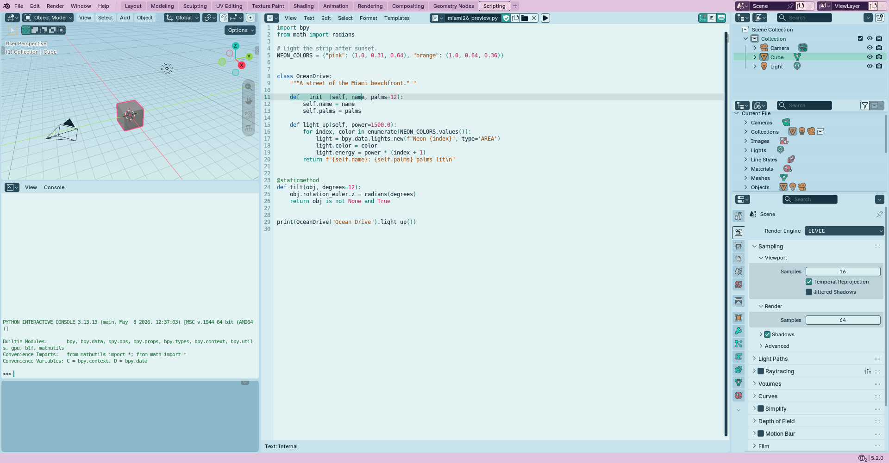
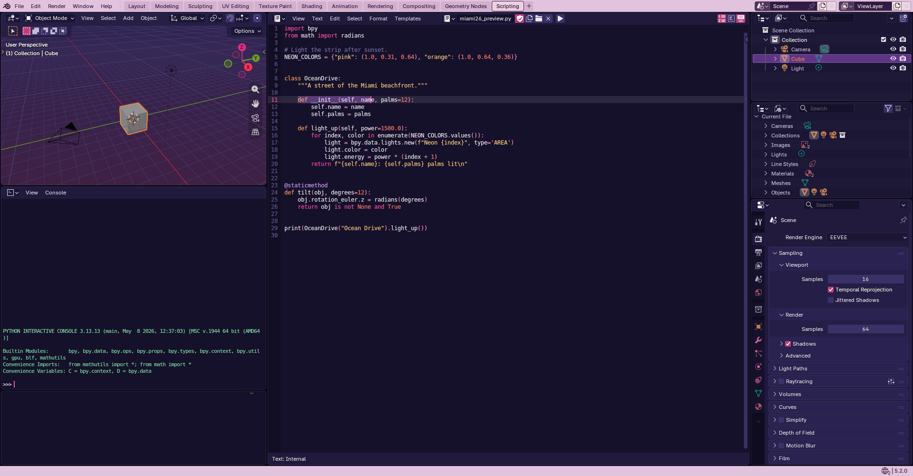
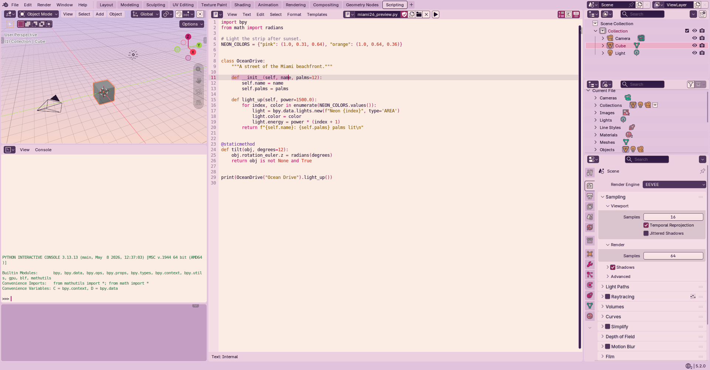

# Miami '26 - Blender themes

[](https://github.com/stillgbx/miami26-blender/actions/workflows/build.yml)
[](https://buymeacoffee.com/stillgbx)

Miami colors for Blender 4.2 and later. Two palettes, each in a dark and a light version:

* **Bay**: a day on the bay. Turquoise water, sky blue, lavender towers, pink facades and warm sand.
* **Sunset**: dusk on the ocean front. Magenta, sunset orange, gold and periwinkle buildings under a violet sky.

| | Dark | Light |
| --- | --- | --- |
| Bay | **Miami '26 Bay** | **Miami '26 Bay Light** |
| Sunset | **Miami '26 Sunset** | **Miami '26 Sunset Light** |

Each theme colors the whole interface, the 3D viewport background (a sky gradient), the text editor and the Python console. Colors that carry a meaning keep their Blender defaults: axes, curve handles, bone, collection and strip colors, node categories, animation states.

Also available for [Visual Studio](https://github.com/stillgbx/miami26-vs) and [VS Code](https://github.com/stillgbx/miami26-vscode).

### Miami '26 Bay



### Miami '26 Bay Light



### Miami '26 Sunset



### Miami '26 Sunset Light



## Install

Blender installs themes as extensions, one per theme.

1. Download the zip of the theme you want from the [latest release](https://github.com/stillgbx/miami26-blender/releases/latest), for example `miami26_sunset-1.0.0.zip`.
2. In Blender, open *Edit > Preferences > Get Extensions*, then *Install from Disk...* in the menu at the top right, and pick the zip.
3. The theme is applied right away. To switch later, pick it in *Preferences > Themes*.

## Credits

Built on the default Blender themes. Inspired by the colors of Miami. This is a fan-made theme, not affiliated with any game or studio.

## Development

Every color lives in `tools/generate-themes.py`, with the same palettes as the Visual Studio and VS Code themes. Each palette gives:

* `ramp`: the colors of the greys of the base theme, by lightness. They draw most of the interface.
* `accent`: the hue of the selection, cursor and playhead, instead of the Blender blue.
* `selection`: the hue of selected and active objects, instead of the Blender orange.
* `ui` and `tokens`: the text editor, the console, the outliner and the 3D viewport gradient.

Then regenerate the four themes (`extensions/<id>/`) and build their zips (`dist/`):

```
python tools/generate-themes.py
python tools/build-extensions.py
```

The bases are `tools/base-dark.xml` (the default theme) and `tools/base-light.xml` (the Blender Light preset). `tools/export-base-themes.py` exports them again from a Blender version:

```
blender --background --factory-startup --python tools/export-base-themes.py
```

To try a theme without installing it, open *Preferences > Themes* and use *Install...* on its XML file in `extensions/<id>/`. `blender --command extension validate dist/<zip>` checks a zip.

### Releasing

1. Increase `VERSION` in `tools/generate-themes.py` and regenerate.
2. Push a tag with the same version, for example `v1.1.0`. The [Build](.github/workflows/build.yml) workflow builds the four zips and attaches them to a new GitHub release.
3. Upload each zip on [extensions.blender.org](https://extensions.blender.org/) (one extension per theme).
